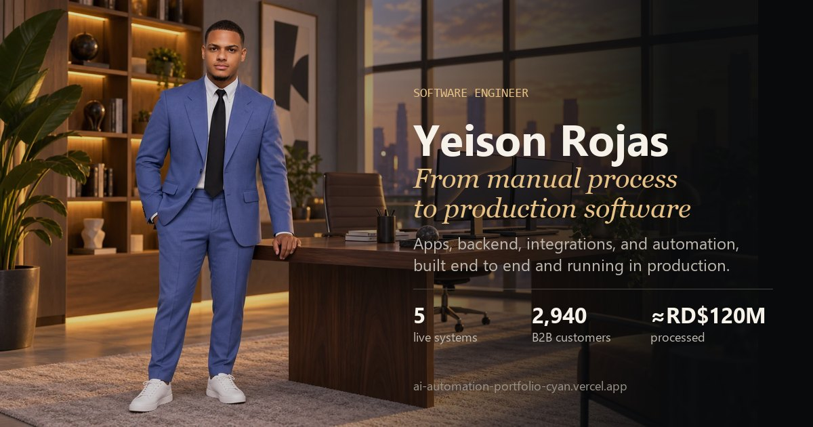

<div align="center">

# Yeison Rojas · Software Engineer

**De proceso manual a software en producción.**
Apps, backend, integraciones y automatización construidos de punta a punta.

[](https://ai-automation-portfolio-cyan.vercel.app/)
[](https://www.linkedin.com/in/yeison-rojas-henriquez/)
[](mailto:yeisonrojas03@gmail.com)

[](https://ai-automation-portfolio-cyan.vercel.app/)

</div>

---

## Sistemas en producción

Cinco sistemas en uso diario. Cada uno tiene su caso completo (reto, lo que construí, resultado e impacto) en el portafolio.

| # | Sistema | Qué resuelve | Stack | Enlace |
|---|---------|--------------|-------|--------|
| 01 | **Plásticos Duralón** | Canal B2B 24/7 de pedidos con precios por cliente, conectado al ERP | iOS · Android · Web · ERP | [App Store](https://apps.apple.com/app/id6805665865) · [Google Play](https://play.google.com/store/apps/details?id=com.plasticosduralon.app) |
| 02 | **Solicitudes legales** | Automatiza la redacción de solicitudes: ≈5 horas recuperadas por semana | Python · Flet · python-docx | [Repositorio](https://github.com/yeisondev001/sistema-de-solicitudes-legales) |
| 03 | **Calidad App** | Muestreos de calidad trazables desde equipos móviles y tablero en tiempo real | Móvil · Web | Código privado |
| 04 | **WMS materia prima** | Trazabilidad con QR desde la recepción hasta el consumo | Flutter · QR | Código privado |
| 05 | **JFProducción** | Une ERP, operación y gerencia para medir eficiencia y explicar pérdidas | Vue 3 · Firebase · ERP | Código privado |

Otros proyectos (MVP técnicos y proyectos personales): [Inventario multi-tienda](https://github.com/yeisondev001/Inventario), BlueWave Plumbing (GoHighLevel), [OjoSafe](https://github.com/yeisondev001/OjoSafe), [Air Draw](https://github.com/yeisondev001/air-draw), [JoJoFanHub](https://github.com/yeisondev001/JoJoFanHub) y [Caja de Herramientas](https://github.com/yeisondev001/toolbox).

---

## Sobre este repositorio

Portafolio hecho con **React 19, TypeScript y Vite**, desplegado en Vercel.

- Cada sección y cada proyecto tiene su propia URL (por ejemplo `/proyecto/duralon-orders`), así que se pueden compartir enlaces directos.
- Versión en inglés y en español.
- Diseño propio para escritorio y para móvil.
- Imágenes en WebP y vista previa al compartir en LinkedIn y WhatsApp.

```bash
npm install
npm run dev      # servidor local en http://localhost:5173
npm run build    # verificación de tipos y build de producción
npm run lint     # lint con Oxlint
```

Las capturas editadas se guardan como versiones nuevas (`-v2`, `-v3`); los originales no se sobrescriben.
